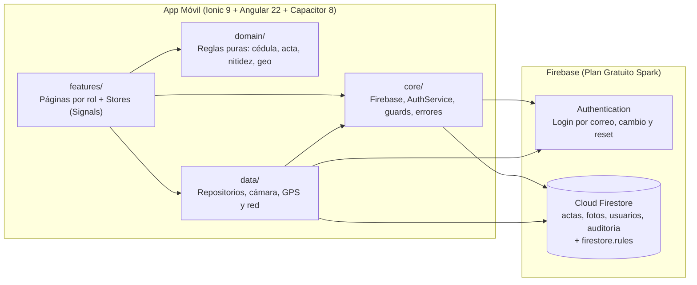

<div align="center">
  <h1>🗳️ EleccionesEPN — Control Electoral Móvil</h1>
  <p><em>Aplicación móvil para el registro, validación y supervisión en tiempo real de actas de escrutinio desde las Juntas Receptoras del Voto (JRV).</em></p>

  <p>
    
    
    
    
    
    
  </p>

  <p>
    <strong>Prueba 2 · Desarrollo de Aplicaciones Móviles · ESFOT — EPN</strong><br/>
    Autor: <strong>Jimy Lucero San Lucas</strong> · Grupo 5
  </p>

  <p>
    <a href="PENDIENTE_ENLACE_RELEASE">📦 APK Release v1.0.0 (25-nov)</a> ·
    <a href="docs/adr/">📐 Decisiones (ADR)</a> ·
    <a href="docs/IA.md">🤖 Uso de IA</a> ·
    <a href="docs/DEFENSA.md">🎓 Guía de Defensa</a> ·
    <a href="docs/setup/PRUEBA-TELEFONO.md">📱 Prueba en Teléfono</a>
  </p>
</div>

---

## 📖 Descripción del Proyecto

**EleccionesEPN** digitaliza el control electoral paralelo desde la mesa hasta la coordinación provincial, garantizando trazabilidad, integridad aritmética de los conteos y operación continua incluso sin cobertura de red.

- **Sin autorregistro:** todas las cuentas se crean por jerarquía desde la propia aplicación y acceden con su **cédula** y la contraseña inicial `Ecuador2026` (con cambio obligatorio en el primer ingreso y recuperación por correo).
- **Backend 100 % en el plan gratuito Firebase Spark:** utiliza únicamente **Firebase Authentication** y **Cloud Firestore**, sin Cloud Functions ni Cloud Storage ([ADR-018](docs/adr/ADR-018-firebase-spark-sin-functions.md)).
- **Seguridad declarativa en el servidor:** toda la autorización por rol y pertenencia a recinto o mesa recae en [`firestore.rules`](firestore.rules), no en ocultar vistas.

---

## ✨ Funcionalidad por Rol

| Rol | Responsabilidades y capacidades |
|---|---|
| **🏛️ Coordinador Provincial** | Lista y crea recintos electorales con sus JRV, crea y asigna coordinadores de recinto, monitorea el avance global y por recinto, revisa ubicaciones GPS (con alertas cuando un acta se registra lejos de su recinto) y consulta el dashboard de votos por dignidad y ámbito. |
| **🏫 Coordinador de Recinto** | Supervisa las mesas (JRV) y el estado de avance de su recinto asignado, crea cuentas de veedores, asigna o reasigna veedores a mesas y corrige datos o fotografías de actas (generando nueva versión auditada). |
| **📋 Veedor de Mesa** | Visualiza únicamente sus mesas asignadas y registra actas de **Alcaldía** y **Prefectura** (5 organizaciones políticas, votos nulos, blancos y total de sufragantes) con cuadre en vivo, foto validada por nitidez, captura GPS, correcciones y trabajo sin conexión. |

### Características Técnicas Clave
- 🧮 **Validación Aritmética en Vivo y en Servidor:** exige que `votos válidos + nulos + blancos == total de sufragantes` antes de habilitar el guardado y lo vuelve a verificar en `firestore.rules`.
- 📷 **Filtro de Nitidez Laplaciano:** evalúa la varianza del kernel Laplaciano en el dispositivo (`src/app/domain/nitidez.ts`) para rechazar actas borrosas antes de comprimirlas (< 700 KB en base64).
- 📍 **Trazabilidad Geográfica:** captura coordenadas con `@capacitor/geolocation` y señala actas registradas fuera del radio esperado del recinto.
- 📵 **Modo Offline Atómico:** el acta, su fotografía comprimida y su registro de auditoría viajan en un solo `writeBatch` que Firestore encola en IndexedDB sin conexión y sincroniza al volver la red, con control optimista de versión ante conflictos ([ADR-010](docs/adr/ADR-010-offline-cache-y-cola-de-fotos.md)).
- 🎨 **Sistema de Diseño Sobrio:** basado en IBM Carbon y tipografía IBM Plex ([DESIGN.md](DESIGN.md)), sin colores asociados a organizaciones políticas.

---

## 🏗️ Arquitectura del Sistema



- **Capas desacopladas ([ADR-003](docs/adr/ADR-003-arquitectura-por-capas.md)):** las páginas y stores no importan el SDK de Firebase directamente; delegan en `data/` y `core/`.
- **Jerarquía sin servidor custom ([ADR-018](docs/adr/ADR-018-firebase-spark-sin-functions.md)):** las cuentas nuevas se crean mediante una instancia secundaria en memoria de Firebase Auth (`crearAuthSecundaria()`), mientras Firestore valida en lote que solo un superior autorizado cree el perfil y su índice en `cedulas/{cédula}`.

### Estructura del Repositorio

```text
EleccionesEPN/
├── src/
│   ├── app/
│   │   ├── core/        # Inicialización Firebase, autenticación, guards y manejo de errores
│   │   ├── domain/      # Modelos, validador de cédula (módulo 10), reglas de acta, nitidez y geo
│   │   ├── data/        # Repositorios Firestore, foto, geolocalización y estado de red
│   │   └── features/    # Pantallas por rol (auth, provincial, recinto, veedor, actas, usuarios)
│   ├── assets/          # Recursos gráficos e ilustraciones de estado
│   ├── environments/    # Configuración Firebase de emulador y producción
│   └── theme/           # Tokens IBM Carbon, variables Ionic y movimiento reducido
├── firestore.rules      # Autorización y validación de integridad en servidor
├── firestore.indexes.json
├── seed/                # Script idempotente de carga inicial y datos demo (seed.mjs)
├── tests/               # Pruebas de reglas (@firebase/rules-unit-testing) e integración
├── e2e/                 # Pruebas de humo móviles con Playwright
├── functions/           # Referencia histórica del diseño anterior en Blaze (no se despliega)
└── docs/                # ADRs (001–018), planificación, guías de setup, IA.md y DEFENSA.md
```

---

## 🗄️ Modelo de Datos (Firestore)

| Colección | ID del Documento | Campos Principales |
|---|---|---|
| `recintos` | Automático | `provincia`, `canton`, `parroquia`, `nombre`, `numJrv`, `lat`, `lng`, `coordinadorId` |
| `jrv` | `{recintoId}_{numero}` | `recintoId`, `numero`, `veedorId` |
| `organizaciones` | `o1`..`o5` | `nombre`, `siglas`, `lista` |
| `candidatos` | `{organizacionId}_{dignidad}` | `organizacionId`, `dignidad` (`ALCALDE` / `PREFECTO`), `nombre` |
| `usuarios` | `uid` | `cedula`, `nombres`, `apellidos`, `telefono`, `email`, `rol`, `recintoId`, `debeCambiarPassword` |
| `cedulas` | `cedula` | `uid`, `email` (índice consultable por ID para login, sin listado) |
| `actas` | `{jrvId}_{dignidad}` | `votos {o1..o5}`, `nulos`, `blancos`, `totalSufragantes`, `fotoPath`, `ubicacion`, `estado`, `version`, `registradoPor`, `updatedBy` |
| `fotos` | `{actaId}_{uuid}` | `actaId`, `jrvId`, `recintoId`, `dignidad`, `mime`, `imagen` (JPEG base64 < 700 KB), `bytes`, `creadoPor` |
| `auditoria` | Automático | `actaId`, `recintoId`, `usuario`, `accion`, `version`, `antes`, `despues`, `fecha` |

---

## 🛡️ Seguridad

- **Aislamiento estricto:** el veedor solo lee y escribe las mesas, actas y fotos asignadas a su `uid`; el coordinador de recinto opera exclusivamente dentro de su `recintoId`; el provincial tiene lectura global y creación de recintos/coordinadores sin editar actas.
- **Integridad de escritura:** Firestore exige enteros no negativos, cuadre exacto de votos, secuencia incremental de `version` y creación simultánea del documento en `auditoria` dentro del mismo `writeBatch`.
- **Protección de cuentas:** un usuario autenticado en Auth sin documento en `usuarios/{uid}` no tiene ningún permiso. Nadie puede autoasignarse rol ni modificar el de terceros.
- **Riesgos documentados ([ADR-018](docs/adr/ADR-018-firebase-spark-sin-functions.md)):** el índice `cedulas/{cédula}` permite obtener el correo asociado conociendo una cédula exacta (no se puede listar), y la validación módulo 10 de cédula reside en cliente mientras el servidor valida longitud numérica de 10 dígitos y unicidad.
- **Cero secretos en Git:** la configuración web (`src/environments/environment.prod.ts`) es pública por diseño; credenciales administrativas, `.env*` y keystores permanecen fuera del repositorio.

---

## 🛠️ Tecnologías Usadas

| Capa | Stack |
|---|---|
| **Frontend & Estado** | Angular 22 (standalone components, Signals), Ionic 9, TypeScript 6, Chart.js 4 |
| **Plataforma Móvil** | Capacitor 8 (Android), `@capacitor/camera`, `@capacitor/geolocation`, `@capacitor/network`, `@capacitor/haptics`, `@capacitor/keyboard`, `@capacitor/status-bar` |
| **Backend (Spark)** | Firebase 13 (Authentication + Cloud Firestore + Rules & Composite Indexes) |
| **Estilos & Tipografía** | SCSS, IBM Carbon Design System ([DESIGN.md](DESIGN.md)), `@fontsource/ibm-plex-sans`, `@fontsource/ibm-plex-mono` |
| **Calidad & Testing** | Vitest, `@firebase/rules-unit-testing`, Playwright, ESLint (`--max-warnings 0`), Prettier |

---

## 🚀 Instalación y Despliegue

**Prerrequisitos:** Node 22, JDK 21, Android SDK y Firebase CLI (`npm install -g firebase-tools`).

### 1. Clonar e instalar dependencias
```powershell
git clone https://github.com/JimSul16/EleccionesEPN.git
cd EleccionesEPN
npm install
```

### 2. Configurar proyecto Firebase (Plan Gratuito Spark)
1. En la consola de Firebase (sin activar Blaze), crear base de datos **Firestore**, activar el proveedor **Correo/contraseña** en Authentication y configurar las plantillas de correo en español.
2. Ajustar `src/environments/environment.ts` (emuladores) y `src/environments/environment.prod.ts` (producción), tomando como plantilla [`src/environments/environment.example.ts`](src/environments/environment.example.ts).
3. Desplegar únicamente reglas e índices de Firestore:
```powershell
firebase deploy --project elecciones-epn --only firestore:rules,firestore:indexes
```

### 3. Ejecución local con Emuladores
En Windows, si la ruta de usuario contiene espacios, define `JAVA_TOOL_OPTIONS` antes de arrancar los emuladores ([docs/setup/EMULADORES.md](docs/setup/EMULADORES.md)):
```powershell
$env:JAVA_TOOL_OPTIONS="-Djdk.net.unixdomain.tmpdir=C:\Users\Public"
firebase emulators:start --project elecciones-epn --only auth,firestore
```

En una segunda terminal, cargar los datos iniciales (`--demo` agrega cuentas de prueba; `--actas-demo` agrega 24 actas ficticias para dashboard y alerta GPS):
```powershell
$env:GCLOUD_PROJECT="elecciones-epn"
$env:FIRESTORE_EMULATOR_HOST="127.0.0.1:8085"
$env:FIREBASE_AUTH_EMULATOR_HOST="127.0.0.1:9099"
node seed/seed.mjs --demo --actas-demo
```

Levantar la aplicación en navegador:
```powershell
npx ng serve
```

### 4. Generar APK Android (Debug)
```powershell
npm run build
npx cap sync android
cd android
.\gradlew.bat assembleDebug
```
Salida generada: `android\app\build\outputs\apk\debug\app-debug.apk`. El APK de entrega final corresponde a una compilación `release` firmada publicada en GitHub Releases (el keystore no se versiona).

---

## 🔑 Credenciales de Demostración

Aplican al entorno de emuladores y al proyecto de demostración sembrado con `seed/seed.mjs --demo`. Todas usan contraseña inicial **`Ecuador2026`** (la app exige cambiarla al primer acceso; las cédulas son ficticias válidas módulo 10).

| Rol | Cédula | Alcance / Mesas |
|---|---|---|
| **Coordinador Provincial** | `1712345675` | Todos los recintos |
| **Coordinadora de Recinto** | `1700000019` | `r01` — Unidad Educativa Los Cedros |
| **Veedor 1** | `1700000027` | `r01` — Mesas 1 y 2 |
| **Veedor 2** | `1700000035` | `r01` — Mesa 3 |

---

## 🧪 Suite de Pruebas

| Suite | Comando | Cobertura |
|---|---|---|
| **Unitarias** | `npm run test:unit` | 41 pruebas (reglas de dominio y guards) |
| **Reglas Firestore** | `npm run test:rules` | 45 pruebas (aislamiento, actas, fotos, alta jerárquica y auditoría) |
| **Integración Auth + Firestore** | ver abajo | 13 flujos completos contra emuladores |
| **E2E Móvil (Playwright)** | `npm run test:e2e` | 4 pruebas de humo en perfil Pixel 7 |
| **Linting** | `npx ng lint --max-warnings 0` | Verificación estática sin advertencias |

```powershell
$env:JAVA_TOOL_OPTIONS="-Djdk.net.unixdomain.tmpdir=C:\Users\Public"
firebase emulators:exec --project demo-elecciones-epn --only auth,firestore "node seed/seed.mjs --demo && node tests/integracion/cuentas.mjs"
```

---

## 📝 Documentación Completa

- [docs/adr/](docs/adr/) — Registros de decisiones de arquitectura (`ADR-001` a `ADR-018`)
- [docs/IA.md](docs/IA.md) — Registro transparente de uso de herramientas de IA (Claude Code, OpenCode y Antigravity)
- [docs/DEFENSA.md](docs/DEFENSA.md) — Guía técnica de defensa del proyecto
- [docs/setup/PRUEBA-TELEFONO.md](docs/setup/PRUEBA-TELEFONO.md) — Protocolo y resultados de validación en dispositivo físico
- [docs/setup/EMULADORES.md](docs/setup/EMULADORES.md) — Configuración de emuladores Firebase en Windows
- [DESIGN.md](DESIGN.md) — Especificación de diseño visual IBM Carbon

<div align="center">
  <i>Desarrollado para la Escuela Politécnica Nacional (EPN - ESFOT)</i>
</div>
