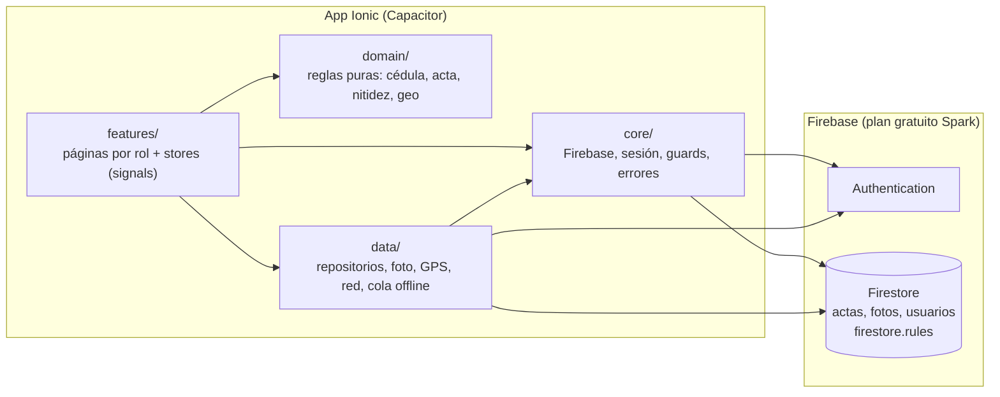

# EleccionesEPN: control electoral móvil

Aplicación móvil para que una organización política registre, valide y supervise los resultados del escrutinio desde las juntas receptoras del voto (JRV). Prueba 2 de Desarrollo de Aplicaciones Móviles, ESFOT, EPN.

- **Autor:** Jimy Lucero San Lucas · Grupo 5
- **APK:** [Release v1.0.0](PENDIENTE_ENLACE_RELEASE) (se publica el 25-nov)
- **Decisiones de arquitectura:** [docs/adr/](docs/adr/) · **Uso de IA:** [docs/IA.md](docs/IA.md) · **Guía de defensa:** [docs/DEFENSA.md](docs/DEFENSA.md)

## Funcionalidad por rol

| Rol | Puede |
|---|---|
| Coordinador provincial | Listar y crear recintos (con sus JRV), crear el coordinador de cada recinto, ver el avance de actas, las ubicaciones GPS (con alerta de actas lejos de su recinto) y el dashboard de votos por candidatura, por dignidad y por recinto o consolidado |
| Coordinador de recinto | Ver las mesas de su recinto y su estado, crear veedores, asignar y reasignar veedores a mesas, corregir datos y fotos de las actas |
| Veedor | Ver solo sus mesas, registrar el acta de alcaldía y de prefectura (5 organizaciones, nulos, blancos, total), con validación de totales en vivo, foto con control de nitidez y GPS; corregir sus actas; trabajar sin conexión |

No hay autorregistro. Todos inician sesión con su **cédula** y la contraseña inicial **Ecuador2026**, que deben cambiar en el primer acceso. La recuperación de contraseña es por correo.

## Stack

| Capa | Tecnología |
|---|---|
| App | Ionic 9 + Angular 22 (standalone, signals), TypeScript 6 |
| Nativo | Capacitor 8 (Android): `@capacitor/camera`, `@capacitor/geolocation`, `@capacitor/network` |
| Backend | Firebase 13 en el **plan gratuito Spark**: Authentication y Firestore (sin Cloud Functions ni Storage, [ADR-018](docs/adr/ADR-018-firebase-spark-sin-functions.md)) |
| Gráficos | Chart.js 4 |
| Pruebas | Vitest, `@firebase/rules-unit-testing`, emuladores de Firebase |
| Diseño | IBM Carbon ([DESIGN.md](DESIGN.md)), IBM Plex vía fontsource |

## Arquitectura



- Las páginas no importan Firebase: hablan con stores, que usan repositorios ([ADR-003](docs/adr/ADR-003-arquitectura-por-capas.md)).
- La autorización real está en `firestore.rules`; los guards solo mejoran la navegación ([ADR-005](docs/adr/ADR-005-modelo-firestore-y-reglas.md)).
- Sin Cloud Functions (plan gratuito): la app del coordinador crea las cuentas y las reglas validan la jerarquía; el rol vive en `usuarios/{uid}`. El APK no contiene claves administrativas ([ADR-018](docs/adr/ADR-018-firebase-spark-sin-functions.md)).

```
src/app/
  core/       firebase.ts, auth.service.ts, guards.ts, errores.ts
  domain/     models.ts, cedula.validator.ts, acta.rules.ts, nitidez.ts, geo.ts, usuario.rules.ts
  data/       *.repository.ts, foto.service.ts, ubicacion.service.ts, red.service.ts, cola-fotos.service.ts
  features/   auth/, veedor/, actas/, recinto/, provincial/, usuarios/, shared/
functions/src/  diseño anterior con Cloud Functions (plan Blaze); no se despliega
seed/           seed.mjs
tests/          rules/reglas.spec.ts, integracion/cuentas.mjs
```

## Modelo de datos

| Colección (Firestore) | ID | Campos principales |
|---|---|---|
| `recintos` | automático | provincia, canton, parroquia, nombre, numJrv, lat, lng, coordinadorId |
| `jrv` | `{recintoId}_{numero}` | recintoId, numero, veedorId |
| `organizaciones` | `o1`..`o5` | nombre, siglas, lista |
| `candidatos` | `{organizacionId}_{dignidad}` | organizacionId, dignidad (ALCALDE, PREFECTO), nombre |
| `usuarios` | uid | cedula, nombres, apellidos, telefono, email, rol, recintoId, debeCambiarPassword |
| `cedulas` | cédula | uid, email (índice para el login; se consulta por ID, no se lista) |
| `actas` | `{jrvId}_{dignidad}` | votos {o1..o5}, nulos, blancos, totalSufragantes, fotoPath (`fotos/...`), ubicacion {lat, lng, precisionM}, estado, version, registradoPor, updatedBy |
| `fotos` | `{actaId}_{uuid}` | actaId, jrvId, recintoId, dignidad, mime (image/jpeg), imagen (base64, menos de 700 KB), bytes, creadoPor |
| `auditoria` | automático | actaId, recintoId, usuario, accion, antes, despues, fecha |

Las fotos se guardan en Firestore (no hay Storage en el plan gratuito), con las mismas reglas por mesa que las actas, y nunca se sobrescriben.

## Seguridad (resumen)

- El veedor solo lee y escribe las mesas, actas y fotos que tiene asignadas; el coordinador de recinto, solo su recinto; el provincial lee todo y no escribe actas.
- El servidor valida que los votos sean enteros no negativos, que **votos + nulos + blancos = total de sufragantes**, la versión del acta (conflictos) y que nadie falsifique su rol, su recinto o el autor.
- El rol está en `usuarios/{uid}`. Solo un coordinador puede crear perfiles, por jerarquía; nadie puede crearse el suyo ni cambiar su rol. Una cuenta de Auth sin perfil no tiene ningún permiso.
- Riesgos aceptados y documentados en ADR-018: quien conozca una cédula registrada puede ver el correo asociado, y el algoritmo módulo 10 de la cédula se valida en la app (el servidor exige 10 dígitos y cédula única).
- La configuración web de Firebase (`apiKey`, `projectId`) es pública por diseño; ningún secreto está en el repositorio.

## Instalación y configuración

Requisitos: Node 22, JDK 21, Android SDK, Firebase CLI (`npm install -g firebase-tools`).

```powershell
npm install
```

1. **App:** `src/environments/environment.ts` y `environment.prod.ts` contienen la configuración web del proyecto Firebase. Para otro proyecto, copia [environment.example.ts](src/environments/environment.example.ts) y completa los valores de la consola de Firebase. En desarrollo `useEmulators: true` conecta la app a los emuladores locales.
2. **Consola de Firebase (una vez, plan gratuito Spark, sin tarjeta):** crear Firestore, activar el proveedor Correo/contraseña y poner en español las plantillas de correo (verificación y restablecimiento).
3. **Deploy** (solo reglas e índices):
```powershell
firebase deploy --project elecciones-epn --only firestore:rules,firestore:indexes
```

## Ejecución local con emuladores

En esta PC el emulador de Firestore necesita la variable de abajo (la carpeta temporal tiene un espacio). Ver [docs/setup/EMULADORES.md](docs/setup/EMULADORES.md).

```powershell
$env:JAVA_TOOL_OPTIONS="-Djdk.net.unixdomain.tmpdir=C:\Users\Public"
firebase emulators:start --project elecciones-epn --only auth,firestore
```

En otra terminal, datos iniciales (R1) y cuentas de demostración:

```powershell
$env:GCLOUD_PROJECT="elecciones-epn"; $env:FIRESTORE_EMULATOR_HOST="127.0.0.1:8085"; $env:FIREBASE_AUTH_EMULATOR_HOST="127.0.0.1:9099"
node seed/seed.mjs --demo --actas-demo
```

Y la app: `npx ng serve`.

El seed carga 6 recintos de Pichincha (cantón Quito) con 33 JRV, 5 organizaciones, 5 candidaturas a alcaldía y 5 a prefectura (todas ficticias). `--demo` crea las cuentas de prueba y `--actas-demo` crea 24 actas para el dashboard (una registrada lejos de su recinto para mostrar la alerta GPS). Es idempotente.

## Credenciales de demostración

Solo para el emulador o el proyecto de demostración. Contraseña inicial de todas: `Ecuador2026` (se pide cambiarla al entrar).

| Rol | Cédula | Mesas |
|---|---|---|
| Coordinador provincial | 1712345675 | todas |
| Coordinadora de recinto (Unidad Educativa Los Cedros) | 1700000019 | recinto r01 |
| Veedor 1 | 1700000027 | r01 mesas 1 y 2 |
| Veedor 2 | 1700000035 | r01 mesa 3 |

Son cédulas generadas con el algoritmo de verificación; no pertenecen a personas reales.

## Pruebas

| Qué | Comando | Resultado al 24-nov |
|---|---|---|
| Unitarias (reglas de negocio y guards) | `npm run test:unit` | 41 pruebas |
| Reglas de seguridad (aislamiento del veedor, validaciones, fotos, alta de cuentas, auditoría) | `npm run test:rules` | 45 pruebas |
| Integración de cuentas y acceso (Auth + Firestore) | ver abajo | 13 casos |
| E2E de humo en navegador móvil (Playwright, Pixel 7) | `npm run test:e2e` | 4 pruebas |
| Lint | `npx ng lint --max-warnings 0` | sin errores |

```powershell
firebase emulators:exec --project demo-elecciones-epn --only auth,firestore "node seed/seed.mjs --demo && node tests/integracion/cuentas.mjs"
```

Prueba en dispositivo: [docs/setup/PRUEBA-TELEFONO.md](docs/setup/PRUEBA-TELEFONO.md).

## Generar el APK

```powershell
npm run build
npx cap sync android
cd android
.\gradlew.bat assembleDebug
```

Salida: `android\app\build\outputs\apk\debug\app-debug.apk`. El APK de entrega es una versión release firmada publicada como Release de GitHub (el keystore no está en el repositorio).

## Sin conexión

El veedor puede registrar actas en modo avión: el acta, su foto y su registro de auditoría van en un solo lote que Firestore guarda en el teléfono y envía al volver la red. Si otra persona corrigió la misma acta mientras tanto, gana la versión del servidor ([ADR-010](docs/adr/ADR-010-offline-cache-y-cola-de-fotos.md)).

## Uso de inteligencia artificial

Se usaron Claude Code, OpenCode y Antigravity con roles separados. Detalle de herramientas, instrucciones, qué se aceptó y qué se descartó, y cómo se verificó en [docs/IA.md](docs/IA.md).
